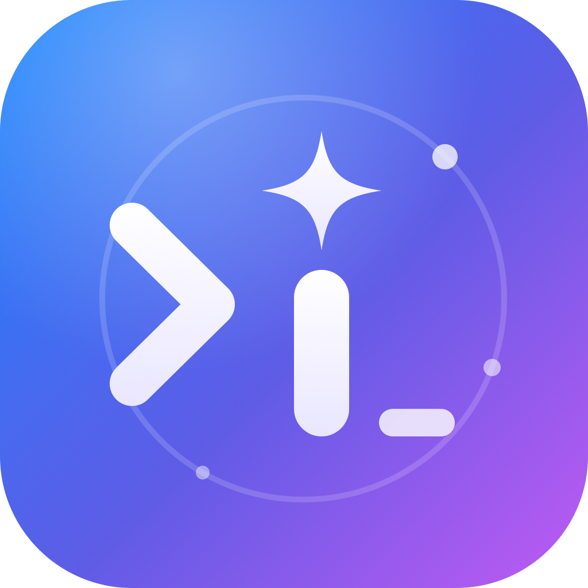
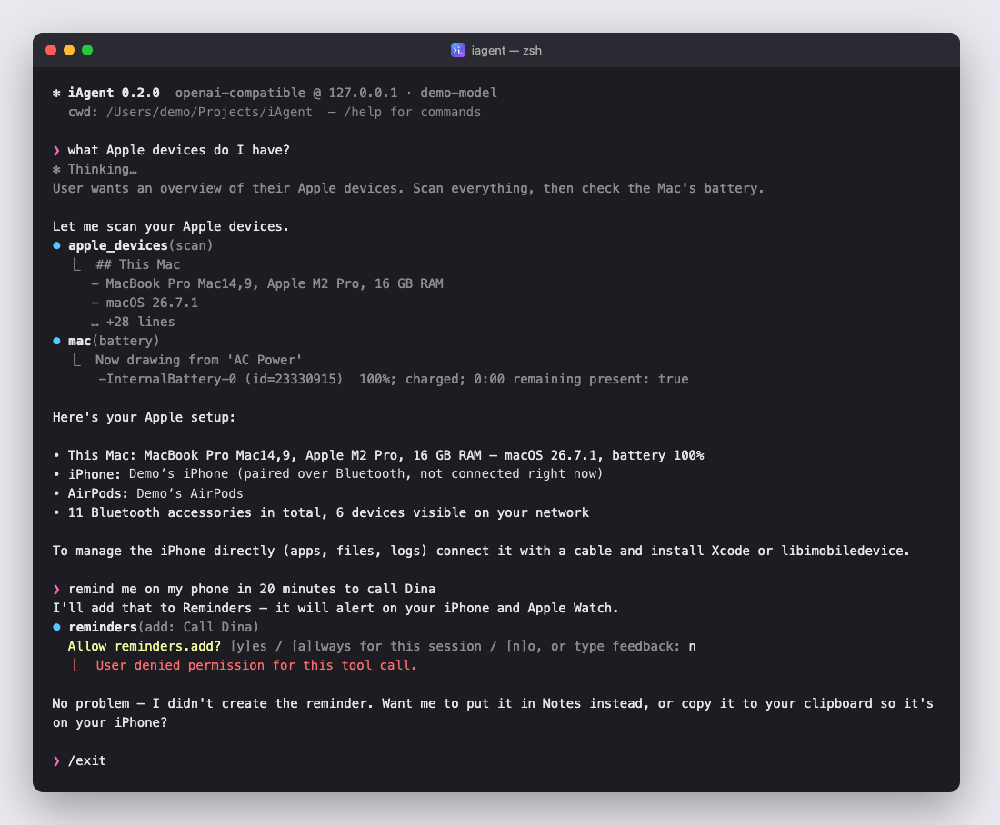

<p align="center">
  
</p>

<h1 align="center">iAgent</h1>

A Claude-Code-style terminal agent written in Swift, with no third-party dependencies. It is wired into the Apple ecosystem: Mac, iPhone, iPad, Watch, Apple TV, AirPods, iCloud data. You can point it at any model:

- **Any OpenAI-compatible server**: OpenAI, OpenRouter, Ollama, LM Studio, vLLM, LiteLLM, Groq, DeepSeek, Together, …
- **Anthropic API** (native Messages API with streaming, adaptive thinking, and prompt caching)

The coding tools are `read_file`, `write_file`, `edit_file`, `glob`, `grep`, `bash`, and `web_fetch`. Before it runs a command, changes a file, contacts a new web host, or touches anything outside the project, you're asked to approve the call (`y` / `a`lways / `n` / type feedback). Secret files and outgoing messages need confirmation every time, even with `--yolo`. See [SECURITY.md](SECURITY.md) for the full security model.

<p align="center">
  
</p>

## Apple ecosystem

On top of the coding tools, the agent gets tools for your whole Apple setup. Just ask in plain language, for example: *"what Apple devices do I have nearby?"*, *"remind me on my phone in 20 minutes to call Dina"*, *"what's on my calendar tomorrow?"*, *"AirDrop report.pdf to my iPhone"*, *"install build/App.ipa on my iPad"*, *"turn off the living room lights"* (via a Shortcut).

| Tool | What it reaches | How |
|---|---|---|
| `apple_devices` | This Mac, USB/Wi-Fi-paired iPhone/iPad/Watch/TV, simulators, Bluetooth accessories (AirPods, keyboards, with battery levels), Apple devices on the LAN (iPhone, iPad, Mac, Apple TV, HomePod) | `system_profiler`, devicectl / libimobiledevice, Bonjour |
| `ios_device` | Physical iPhone / iPad / Watch / Apple TV: info, battery, apps, processes, install/uninstall/launch, copy files in and out of app containers, screenshot, syslog | `xcrun devicectl` (Xcode), falls back to `libimobiledevice` |
| `simulator` | iOS/iPadOS/watchOS/tvOS/visionOS simulators: boot, install, launch, open URL, screenshot, push notification, appearance, location | `xcrun simctl` (Xcode) |
| `airdrop` | Send files/URLs to a nearby iPhone, iPad or Mac (you pick the recipient in the AirDrop sheet) | `NSSharingService` |
| `reminders` | Lists, list, add (a due time also alerts on iPhone/Watch), complete, delete | EventKit, iCloud sync |
| `calendar` | Calendars, events in a range, add (with alert), delete | EventKit, iCloud/Google/Exchange |
| `contacts` | Search by name, email or phone | Contacts framework |
| `notes` | Folders, recent, search, read, create, append | Notes.app via JXA |
| `messages` | Send an iMessage/SMS (with an optional attachment) | Messages.app via AppleScript |
| `shortcuts` | List and run your Shortcuts, which also covers HomeKit/Home, Focus modes and app actions | `shortcuts` CLI |
| `mac` | Notification, say, clipboard (Universal Clipboard puts it on your iPhone/iPad), open URL/app/file, screenshot, volume, dark mode, battery, Wi-Fi, running apps, now playing, display sleep | built-in commands |
| `applescript` | Any scriptable Mac app (Music, Safari, Mail, Finder, Photos, Keynote, …) | `osascript` |

**Setup for iPhone/iPad over USB/Wi-Fi.** Install Xcode for `devicectl`/`simctl`, or run `brew install libimobiledevice` for the USB-only basics. Then connect the device, unlock it, and tap **Trust**.

**Privacy prompts.** macOS asks once per capability: Reminders, Calendars, Contacts, Automation (Notes/Messages/System Events), Screen Recording (screenshots), and Local Network (Bonjour scan). Approvals are stored for your terminal app under System Settings → Privacy & Security. The binary embeds an `Info.plist` with usage descriptions, so these prompts work.

**Approvals.**
- Read-only actions (device scans, listing reminders/events, battery, …) run without asking.
- Personal data reads (contacts, notes, clipboard) and any change ask first. `--yolo` or answering `a` skips the prompt.
- `messages` always asks before each message, even with `--yolo`, and can't be used in non-interactive runs. The same goes for reading secret files (`.env`, SSH/cloud keys) and writing shell-startup files.

**Not possible from macOS:**
- Find My locations.
- Remotely controlling another device's screen.
- Reading iPhone app data outside app containers.
- Reading your Messages history.

Apple TV/HomePod playback control needs a third-party tool such as `pyatv`. Use `--no-apple` to drop these tools for small models.

Debug a tool without a model:

```bash
iagent --run-tool apple_devices '{}'
iagent --run-tool reminders '{"action":"lists"}'
iagent --run-tool mac '{"action":"battery"}'
```

## Build & install

```bash
cd iAgent
scripts/build-release.sh                   # release build, signed with the hardened runtime → dist/iagent
cp dist/iagent /usr/local/bin/             # or anywhere on PATH
```

Requires macOS 14+ and Swift 5.9+. Xcode is optional but needed for iPhone/iPad management and simulators.

## Usage

```bash
iagent                                  # interactive session
iagent "explain this repo"              # interactive, starting with a prompt
iagent -p "fix the failing test" --yolo # one-shot, auto-approve tools
git diff | iagent -p "review this diff" # one-shot from stdin
```

REPL commands: `/help`, `/model [id]`, `/clear`, `/tools`, `/yolo`, `/cost`, `/exit`.
Ctrl-C stops the running turn, and Ctrl-C at the prompt exits. End a line with `\` to keep typing on the next line.
To get arrow-key history, run it under `rlwrap iagent`.

## Choosing a model

| Provider | Command | Key env var |
|---|---|---|
| Anthropic | `iagent --provider anthropic` (default model `claude-opus-5-5`) | `ANTHROPIC_API_KEY` |
| OpenAI | `iagent --provider openai -m gpt-5` | `OPENAI_API_KEY` |
| OpenRouter | `iagent --provider openrouter -m qwen/qwen3-coder` | `OPENROUTER_API_KEY` |
| Ollama | `iagent --provider ollama -m qwen3-coder` | – |
| LM Studio | `iagent --provider lmstudio -m <loaded-model>` | – |
| Any OpenAI-compatible | `iagent --base-url http://host:8000/v1 -m <id> --api-key-env MY_KEY` | your choice |
| Anthropic-compatible gateway | `iagent --base-url https://gw.example.com --kind anthropic -m <id>` | `ANTHROPIC_API_KEY` |

If you don't pass `--provider`, the provider is picked from the first key env var that is set: `ANTHROPIC_API_KEY`, then `OPENAI_API_KEY`, then `OPENROUTER_API_KEY`. If none are set, it uses local Ollama.

The model needs to support tool/function calling. Small local models often struggle with multi-step agent work.

## Config file

Settings are applied in this order, with later ones winning: `~/.iagent/config.json`, then `IAGENT_*` env vars, then CLI flags.

```json
{
  "profile": "local",
  "profiles": {
    "local":  { "provider": "ollama", "model": "qwen3-coder" },
    "claude": { "provider": "anthropic", "model": "claude-opus-5-5", "effort": "high" },
    "router": { "provider": "openrouter", "model": "anthropic/claude-sonnet-5-5" },
    "corp":   { "baseURL": "https://llm.internal/v1", "apiKeyEnv": "CORP_LLM_KEY", "model": "llama-4",
                "headers": { "X-Team": "devops" } }
  }
}
```

To switch profiles for a single run: `IAGENT_PROFILE=claude iagent`. Other env vars: `IAGENT_PROVIDER`, `IAGENT_MODEL`, `IAGENT_BASE_URL`, `IAGENT_API_KEY`, `IAGENT_EFFORT`.

Keys: `provider`, `kind` (`openai`|`anthropic`), `baseURL`, `model`, `apiKey`, `apiKeyEnv`, `apiKeyKeychain` (+ optional `apiKeyKeychainAccount`), `maxTokens`, `effort`, `thinking` (bool), `headers`, `allowInsecureHTTP` (bool), `appleTools` (bool).

Store the API key in the macOS Keychain instead of the file:

```bash
security add-generic-password -s iagent-anthropic -a iagent -w   # prompts for the key
```

Then reference it in the profile: `{ "provider": "anthropic", "apiKeyKeychain": "iagent-anthropic" }`. Never put a plaintext `apiKey` in the file. If you must, `chmod 600 ~/.iagent/config.json`; iAgent warns if other users can read it.

Remote servers must use `https://`. Plain `http://` is accepted only for localhost/LAN servers such as Ollama and LM Studio.

## Project instructions

If the working directory has an `AGENTS.md`, `CLAUDE.md`, or `.iagent.md`, it is added to the system prompt.

## Anthropic specifics

- Requests use adaptive thinking (shown dimmed as it streams) with `output_config.effort` (`--effort`, default `high`). Use `--no-thinking` for models without adaptive thinking. It is skipped automatically for Haiku.
- Assistant content blocks, including thinking blocks and their signatures, are sent back unchanged on later turns. The history is append-only.
- Prompt caching is on (`cache_control` at the top level), so the conversation prefix is reused across tool-loop iterations. You can see cache reads with `/cost`.
- On `api.anthropic.com`, two more things are turned on:
  - `eager_input_streaming` for tools.
  - Server-side refusal fallbacks (`fallbacks: "default"`) for Opus 5.5 / Opus 5 / Fable 5.1 / Sonnet 5.5.

  Neither is sent through custom gateways.

## Layout

```
Sources/iAgent/
  main.swift               CLI flags, REPL, slash commands, one-shot mode
  Agent.swift              agent loop (model → tools → model …), system prompt, stream renderer
  Config.swift             presets, config file / env / flag resolution
  Models.swift             message types, provider protocol, HTTP+SSE helpers with retry
  OpenAIProvider.swift     Chat Completions streaming + tool calls
  AnthropicProvider.swift  Messages API streaming + tool_use/tool_result
  Tools.swift              coding tools + permission/approval prompts
  Process.swift            argv-based process runner, osascript bridge
  AppleDevices.swift       apple_devices, ios_device, simulator, airdrop (+ Bonjour, AirDrop helper)
  ApplePIM.swift           reminders, calendar, contacts, notes, messages
  AppleMac.swift           shortcuts, mac, applescript
  Support.swift            terminal styling, JSON helpers, Ctrl-C handling
  Security.swift           output sanitizer, path policy, secret scrubbing, transport rules
Tests/iAgentTests/
  SecurityTests.swift      regression tests for every control in SECURITY.md
  ToolTests.swift          coding-tool behavior (read/write/edit/glob/grep/bash/web_fetch, invalid JSON)
Info.plist                 privacy usage descriptions embedded into the binary
iAgent.entitlements        hardened-runtime entitlements (Apple Events, Calendars, Contacts only)
scripts/build-release.sh   signed release build
SECURITY.md                threat model, controls, standards mapping, residual risks
AGENTS.md                  architecture and conventions for contributors and coding agents
```

Run the tests with `swift test < /dev/null`. Redirecting stdin makes the session non-interactive, which enables the tests that check approvals are refused without a terminal.

Adding a tool means adding one `Tool(...)` to `Toolbox` (or `AppleTools.all`). It works with both providers.
